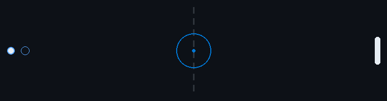

 

Programador · **C++ (Win32) · Python · JS/TS · Web**

 

 

**Herramientas**     

---

## Proyectos

| Proyecto | Descripción | Stack |
|:--|:--|:--|
| [**organizador-archivos**](https://github.com/Ngro-prog/organizador-archivos) | Organizador de archivos para Windows: mueve archivos sueltos a `Categoría\Año\Mes`, con simulación, deshacer y modo vigilante en la bandeja del sistema. | `C++17` `Win32` |

---

## Actividad

  

---

 

---

**Contacto** · [@Ngro-prog](https://github.com/Ngro-prog)

